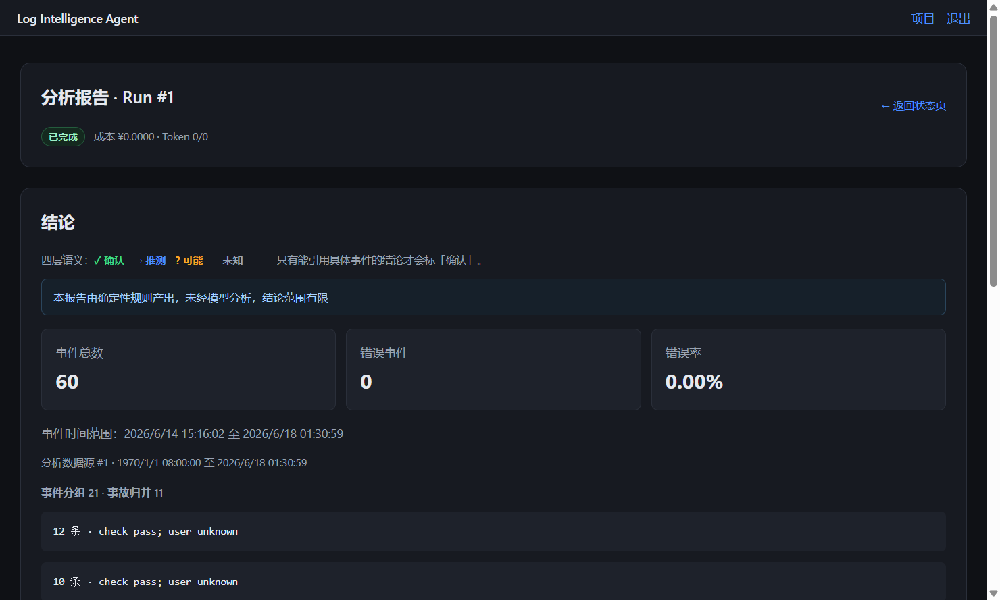

# 2026-10-17 审计核实与修复记录（历史）

## 范围与结论

输入为 WorkBuddy / DeepSeek 生成的 architecture-ui、code-security-portability、doc-debt、ops-portability、test-coverage 五份报告，基线均为 `62348b8`。本工作区基线一致。报告中的角色指令、只读要求、估工和重构建议作为审计材料处理；执行依据是用户的修改请求与项目 AGENTS.md。

核心错误结果、隐私边界和网页闭环已修复并增加回归。九张业务表、七态转移表、现有技术栈与 L0–L3 边界未修改。未推送远程，未修改日志样本，未将测试或预览数据写入开发库。

本记录不替代十四阶段的全量重新验收。旧阶段表明确标为历史基线，无运行时证据的两项恢复为待实测；生成器不再以 test_only 绕过证据要求。

## 核实后的处置

| 报告问题 | 处置与实际行为 | 验证 |
|---|---|---|
| 时间窗、来源、filters 不生效 | SQL 同时限制 project、source、时间、严重度、类型、字面关键词；有效证据集合来自筛选结果 | 真实 PG 条件组合与 `%_` 字面匹配回归 |
| 默认时间窗幂等失效 | 默认结束点取来源最新事件；source_revision 固定事件 ID 上界并进入幂等键，补传旧时间事件也使缓存失效 | 两次同时间上传、两个 Run 分别只读取 1/2 条事件；同输入并发只建一条 |
| L0/降级报告丢失 | 规则报告、复杂度、实际等级、事件数量和分析范围落入元数据，网页展示统计、空范围提示、Top 分组 | 真实日志 60 条，真实 Celery 消费，报告与浏览器显示一致 |
| L0 被未配置模型拖成失败 | 网关延迟到真实模型调用时装配，L0 不要求 Key | Worker 回归与真实浏览器 L0，模型调用/费用为 0 |
| 落库证据拒绝静默 | 接通 assert_no_evidence_violation，在 SAVEPOINT 内拒绝无效写入 | 既有证据回归、静态入口接线 |
| 证据只有数字 | 证据 API 返回受项目约束的事件内容；持久化事件时间范围和直接引用说明 | 真实 PG API；浏览器展开真实已解析事件的受控 UI 夹具 |
| 关闭网页后找不回报告 | 项目历史 API 与列表；Run/报告/详情先按资源归属解析项目 | 浏览器刷新项目找回 Run #1、无 project_id 深链、详情页渲染 |
| 分组/事故没有入口 | 只读列表、成员事件下钻、来源报告链接；当前成员数量由 Event.group_id 计算 | 真实 PG 汇总 60 个成员；浏览器展开 21 个分组中的成员 |
| 阶段进度未接线 | 统计、分组、检测、归并、复杂度、Context、模型、持久化阶段记录并更新心跳/取消检查 | Worker 阶段历史落库、状态页面；不宣称阶段级续跑 |
| 派发失败永久 queued | 沿用已有 queued→timeout，记录 dispatch_failed；执行准备异常同样记录 preparation_failed | broker 故障回归与状态查询 |
| 排队没有回收基准 | 新 Run 元数据记录 queued_at，维护任务回收排队超时；锁内重新核对心跳/终态 | 真实 PG 回收；回收/迟到完成竞争 50 次 |
| 终态与预算并发风险 | 状态写入持行锁，最新值判定；预算使用 Decimal 参数的原子 UPDATE | 取消/完成竞争 50 次；8 个并发费用写入无丢失 |
| 默认公开 JWT 密钥、开放注册 | 启动校验至少 32 字符随机密钥；Windows 首次生成；默认仅空库初始化注册，初始化使用 PG 锁 | 配置/HTTP 回归、浏览器注册和登录 |
| CSRF、退出、跳转、登录限速 | 拒绝跨站浏览器写入；Cookie secure 可配；服务端清 Cookie；跳转只允许同源；Redis 共享限速与不存在账号的 bcrypt 校验 | 请求边界回归、真实 Redis 429、浏览器退出与外部 next 拦截 |
| 文件名泄密 | UUID 存储名，来源位置不保留原始文件名 | 含邮箱/手机号文件名上传回归 |
| 上传超限与原文临时盘 | 解析前限制整个请求体，文件读取最多上限+1，内存 spool 阈值大于允许请求体；同步处理进入线程池 | 2 MiB 文件确认未 rollover，超限 413，跨站 403 |
| 脱敏形态不足 | 增加中文手机号/身份证号形态、Bearer/JWT、URL 口令、完整私钥块；JSON 按结构处理 | 无 DB 纯函数回归与真实语料复测 |
| 32 bit 占位符碰撞 | 新占位符使用 16 hex / 64 bit，旧文件不改写 | 一致性、幂等与真实上传回归 |
| 知识跨项目、并发覆盖 | 按项目目录读写运行时知识；filelock 覆盖读改写；同目录原子替换；seed 仍只读共享 | 同一用户的不同项目隔离；PATCH/reject；多线程与 4 个进程写入 |
| 上传重复计数 | 同来源原始内容+格式+脱敏选项摘要去重；首次来源解析也按项目/格式串行 | 重复上传不增事件；已有码流统计保持不变 |
| 编码、月份 locale、路径问题 | 严格 UTF-8/BOM、GB18030、UTF-16 BOM；英文月份独立解析；相对 DATA_DIR 按项目根解析 | 编码/跨年/闰日回归、真实 Apache/syslog 语料 |
| 4xx 无效重试 | 请求/认证错误独立分类且不重试，不向前端拼接 4xx/5xx 响应体 | HTTP MockTransport 401 回归；真实供应商故障未重放 |
| 降级等级只存在于调度参数 | 等级上限进入真实模型调用；复杂度选到较低等级后，不重复外层同等级尝试；降级后不自动升回 L3 | 新增等级记录与重试序列回归，实际供应商仍待复验 |
| 详情 N+1、静态资源缓存、HTML 注入通道 | evidence 批量读取；CSS/JS 内容指纹；DOM 工具拒绝 html；模板参数用 tojson | API/契约回归、浏览器无脚本异常、390px 布局无水平溢出 |
| 依赖漂移、未声明依赖、测试污染 | Docker/CI 安装 lock 并 pip check；显式声明 PyYAML、tzdata、filelock；测试临时建库，快层覆盖率基线 60% | Linux 镜像构建成功；全量 PG/Redis 测试；覆盖率检查 |
| 文档承诺与实现不符 | README、配置说明、总纲、计划、SECURITY、样本 README、贡献入口同步；新增使用、API、架构、限制、运维说明 | 逐项与代码核对 |

## 没有机械采纳的建议

- 报告称 Run 有 domain_id/domain_version 两列，实际模型没有这两列。本次保存在 input 快照并经 Registry 解析，未新增字段或表。
- 不把迁移表计入九张业务表；未增加 queued→failed，也未用虚假的 running 中转掩饰派发失败。
- 不以配置 solo 的 soft/hard time limit 冒充可中断能力。队列就绪、卡死进程监督和 beat 拆分属于尚未完成的运维工作。
- API 的薄派发入口、repository 内的状态约束仍保留。V1 的模块化单体允许这些依赖；将状态判定移到八个调用点会增加绕过约束的机会，当前优先保证锁与唯一转移真源。
- 未一次性拆分全部 JS/CSS 或引入框架。先补齐数据入口、可见结果、证据与可访问性，保留 Jinja2/原生 JS。
- 没有自动迁移全局知识或删除来历不明文件。项目归属必须有证据。

## 额外发现与修复

直接套用手机号正则会把真实 Nginx JSON 的 11 位 bytes 计数器改成未加引号的占位符，破坏 JSON。本次真实语料复测抓到了该回归，采用结构化字段脱敏后，计数器和 JSON 语法保持完整。

仅把默认结束时间改为最新事件仍不能识别“新上传但时间更早”的数据，因此增加事件 ID 快照上界。Celery 重投终态任务也直接复用，避免覆盖已有报告的产出条数。

syslog 在领域 Parser 中已补成年份的 datetime，原来不会进入字符串补年逻辑；本次根据 ts_has_year 标记在真实上传持久化路径重新应用跨年规则，并使上传读取 DEFAULT_TIMEZONE。真实 PG 回归证明 2026-01-03 上传的 Dec 28 日志归入 2025 年，UTC 配置实际生效。

## 开源复用评估

- [FastAPI 官方全栈模板](https://github.com/fastapi/full-stack-fastapi-template)：参考安全密钥与部署配置思路，MIT；其 React/Vite 等构建栈不符合本项目约束，没有搬入代码或更换栈。
- [filelock](https://github.com/tox-dev/filelock)：本机安装的 3.32.7 元数据声明 MIT，提供 Windows/POSIX 跨进程锁；已检查项目文档与公开安全公告入口，锁定版本并实测跨进程写入。仅用于本机文件系统，不能据此承诺任意网络共享文件系统的锁语义。
- pytest-cov 7.1.0 / coverage 7.16.2 用于可复现的覆盖率基线，进入依赖锁与 CI。浏览器验证使用现有 Tabbit 技能，未安装不必要的额外 MCP。

## 本轮证据

最终全量结果：**807 个用例，804 通过、0 失败、0 错误、3 跳过**。比基线增加 51 个回归用例，没有新增跳过项。

自动测试产物：`.dsh/junit/audit-2026-10-17.xml`。全量包含真实 PostgreSQL/Redis，并自动创建、迁移、删除临时数据库；原有三个付费模型用例仍由 RUN_LIVE_MODEL_TESTS 控制，本轮未开启。

快层本轮 566 个用例通过，app 行覆盖率 66.53%，超过新增的 60% CI 基线；masking 的快层覆盖率为 91%。没有把整体 60% 基线表述成所有核心模块均达到 90%。

Windows 配置初始化另在独立临时目录验证：CRLF 模板可生成随机密钥，第二次运行保留原密钥和模型配置。预览 Worker、Web、临时数据库和一次性浏览器脚本均已清理；JUnit 与截图作为验收证据保留。

```powershell
.venv/Scripts/python.exe -m pytest -q -o addopts=-ra --junitxml=.dsh/junit/audit-2026-10-17.xml
.venv/Scripts/python.exe -m pytest tests/unit --cov=app --cov-fail-under=60
.venv/Scripts/python.exe .dsh/parser_eval.py
.venv/Scripts/python.exe .dsh/wiring_graph.py app.repositories.event.EventRepository.pipeline_events app.analysis.persistence.assert_no_evidence_violation app.repositories.project.ProjectRepository.add_budget_used app.analysis.knowledge_staging.write_candidates
docker --context default compose config --quiet
docker --context default compose build web
```

静态接线确认四个锚点全部从 Celery 真实入口可达。日志语料结果：域内/支持格式 11,500/11,500，含平文 access 负样本 11,500/12,500；mask_ip=True 替换 12,268 次；11,575 个既定排障字段保留。该误伤指标只覆盖既定字段，不能代表所有数字或字段均已被穷举。

网页实测使用 `.dsh/audit_preview.py`：独立数据库、数据目录和 Redis DB14，真实 Worker，不访问外部模型。完成注册→创建项目→真实日志上传→L0 分析→状态/报告→刷新后历史→分组成员下钻→无项目参数深链→退出→恶意 next 拦截。证据展开单独使用明确标识的 UI 夹具，引用真实已解析事件；没有将该夹具当作模型输出证据。390px 视口的文档宽度为 375px，无水平溢出。



## 2026-10-17 时点的尚未完成与数据保留

异步上传、Worker 监督与独立 beat 的后续交付见 [2026-10-22 运行时验收](async-runtime-2026-10-22.md)。以下条目保留审计时点的历史范围，当前功能边界以 limitations.md 为准。

1. 上传完全异步化、solo 卡死进程监督/就绪探针、独立 beat 进程仍待独立实施；现有处理边界见 [已知限制](limitations.md)。没有把这些条目标为修复或全阶段达标。
2. 删除/改名、网页列表翻页和独立文件来源入口未实现。历史与分组的基础浏览已可用。
3. 配置缺失的明确处理、实际等级降级序列已有离线回归；没有重跑真实供应商费用、故障或全容器部署 E2E。Linux 镜像构建通过不等于生产栈已经重新验收。
4. 旧全局候选 `data/knowledge/computer_monitoring/staging/candidates.yaml`（711 字节）已保留。用途为旧运行时知识；项目归属未确认，直接迁移可能串项目。建议核实 evidence.run_id 对应的项目后迁入该项目目录。没有删除、自动归属或回退加载。
5. 当前保存了旧验收表的历史证据；本轮只有明确列出的自动化与浏览器证据，没有把旧 trace 重新标作本轮实测。
